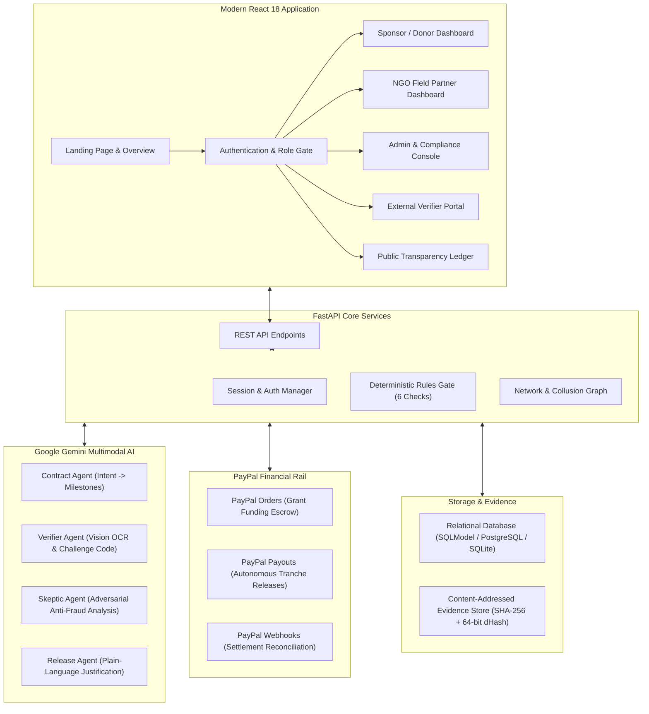
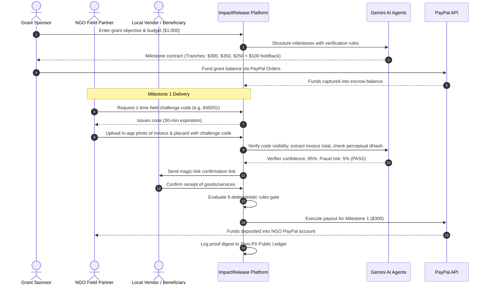

# ImpactRelease

**ImpactRelease** is an automated, milestone-verified grant escrow and disbursement platform for donors, NGOs, and humanitarian organizations. Donors state their program objective in plain language, AI structures it into measurable, checkable tranches, and funds are automatically released via **PayPal Payouts** only when physical field evidence, invoices, and independent third-party attestations pass multi-angle verification.

---

## The Problem Statement

Traditional charitable grants and humanitarian aid suffer from high leakage, delayed accountability, and donor distrust:
1. **Lump-Sum Disbursal Risks:** Billions in philanthropic and CSR capital are wired upfront with little guarantee that milestones are fulfilled as promised.
2. **Slow, Manual Audits:** Donors and CSR committees rely on delayed PDF reports submitted months after funds are spent, making corrective action impossible.
3. **Evidence Tampering & Duplicate Invoices:** Without cryptographic checks, bad actors can submit duplicate receipts, stock photos, or recycled invoices across grants.
4. **Beneficiary Exclusion:** Communities receiving aid rarely have a voice to verify whether goods, textbooks, clean water wells, or medical relief actually reached them before final payouts occur.

---

## The Solution: How ImpactRelease Works

ImpactRelease replaces blind upfront donations with **programmable, milestone-based grant escrow**:
- **Plain-Language Intent to Milestones:** Donors describe any initiative (e.g. disaster relief, water well construction, pediatric eye surgeries, textbook distribution). The AI Contract Agent breaks it down into chronological, budget-balanced milestones with concrete verification criteria.
- **Ring-Fenced PayPal Escrow:** Grants are funded upfront via **PayPal Orders API** and held securely until deliverables are independently proven.
- **Multimodal Field Verification:** Field officers show a live, single-use 6-digit challenge code alongside goods or receipts. The system computes SHA-256 and 64-bit perceptual image hashes (`dHash`) to block duplicate or cropped photos.
- **Multi-Party Attestation:** Magic links are sent to local vendors and community beneficiaries to independently confirm receipt of payment or delivery.
- **Autonomous Release Engine:** A 6-rule deterministic safety gate evaluates funding, verification confidence, fraud risk, independent confirmations, and dispute status before triggering instant **PayPal Payouts**.
- **Retention Holdback & Public Transparency:** A 10% holdback is reserved until the entire program completes with zero open disputes, while zero-PII cryptographic proofs are logged on an open public ledger.

---

## System Architecture



---

## End-to-End Workflow



---

## Role-Based Dashboards

ImpactRelease provides distinct, role-segregated workspaces:

1. **Grant Sponsor Dashboard:**
   - Define grant objectives and view active portfolios.
   - Review AI-structured milestones and fund balances via PayPal.
   - Monitor disbursement progress bars and authorize final retention holdbacks.

2. **NGO Field Partner Dashboard:**
   - View assigned deliverables and generate one-time 6-digit verification codes.
   - Capture field proof via WebRTC live camera or file upload (`PNG`, `JPG`, `PDF`).
   - Run AI anti-fraud inspection and trigger tranche disbursements upon meeting rules.

3. **External Verifier Portal:**
   - Zero-login, tokenized verification magic-links for suppliers, local vendors, and community representatives.
   - Confirm delivery terms or raise a challenge-window dispute to freeze funds.

4. **Compliance & Admin Console:**
   - AG Grid case escalation queue for flagged submissions and whistleblower reports.
   - Inspect fraud risk signals, side-by-side evidence, and issue manual approve/reject overrides.
   - Cross-grant collusion detector flagging shared hardware devices and repeat confirmer rings.

5. **Public Transparency Portal:**
   - Zero-PII public ledger for donors and public auditors.
   - Searchable, categorized chronological security audit trail.

---

## Tech Stack

| Layer | Technologies |
|---|---|
| **Frontend** | React 18, Vite 5, Tailwind CSS 3, AG Grid Community, Lucide React |
| **Backend** | FastAPI, SQLModel / SQLAlchemy, Python 3.11, Pydantic v2 |
| **Artificial Intelligence** | Google Gemini Multimodal Vision API (`gemini-3.1-flash-lite`, `gemini-2.5-flash`) |
| **Anti-Fraud & Forensics** | SHA-256 cryptographic hashing, 64-bit perceptual difference hashing (`dHash`), Jaccard similarity |
| **Payments Rail** | PayPal REST API (Orders v2, Payouts v1, Webhook verification) |
| **Database** | SQLite (development/testing) / PostgreSQL (production) |
| **Deployment** | Docker multi-stage builds, Render (`render.yaml`), Docker Compose |

---

## Running Locally

### Prerequisites
- Python 3.11+
- Node.js 18+ and npm
- A Google Gemini API key (`GEMINI_API_KEY`)

### 1. Setup Backend
```powershell
cd backend
python -m venv ..\.venv
..\.venv\Scripts\pip install -r requirements.txt
copy ..\.env.example ..\.env
```
*Note: In `.env`, add your `GEMINI_API_KEY`. `PAYPAL_MODE=stub` works out of the box with no PayPal credentials needed for local testing.*

### 2. Setup & Build Frontend
```powershell
cd ..\frontend
npm install
npm run build
```

### 3. Run Application
```powershell
cd ..\backend
..\.venv\Scripts\python -m uvicorn app.main:app --reload --port 8000
```
- Open your browser at **http://localhost:8000** to view the live platform.
- API Swagger documentation is available at **http://localhost:8000/docs**.

### 4. Running Tests
```powershell
cd backend
..\.venv\Scripts\python -m pytest -q
```

---

## License
MIT License. See [LICENSE](LICENSE) for details.
