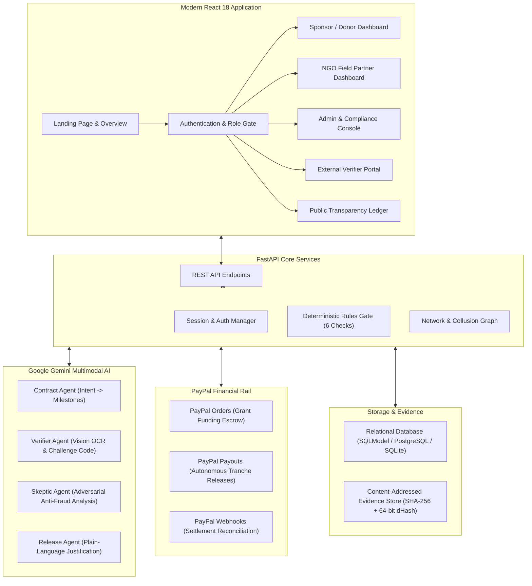
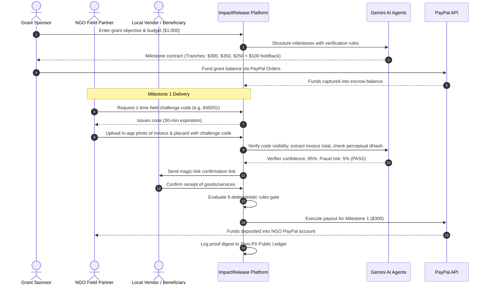

# ImpactRelease

**ImpactRelease** is an automated, milestone-verified grant escrow and disbursement platform for donors, NGOs, and humanitarian organizations. Donors state their program objective in plain language, AI structures it into measurable, checkable tranches, and funds are automatically released via **PayPal Payouts** only when physical field evidence, invoices, and independent third-party attestations pass multi-angle verification.

---

## The Problem Statement

Traditional charitable grants and humanitarian aid suffer from high leakage, delayed accountability, and donor distrust:
1. **Lump-Sum Disbursal Risks:** Billions in philanthropic and CSR capital are wired upfront with little guarantee that milestones are fulfilled as promised.
2. **Slow, Manual Audits:** Donors and CSR committees rely on delayed PDF reports submitted months after funds are spent, making corrective action impossible.
3. **Evidence Tampering & Duplicate Invoices:** Without cryptographic checks, bad actors can submit duplicate receipts, stock photos, or recycled invoices across grants.
4. **Beneficiary Exclusion:** Communities receiving aid rarely have a voice to verify whether goods, textbooks, clean water wells, or medical relief actually reached them before final payouts occur.

---

## The Solution: How ImpactRelease Works

ImpactRelease replaces blind upfront donations with **programmable, milestone-based grant escrow**:
- **Plain-Language Intent to Milestones:** Donors describe any initiative (e.g. disaster relief, water well construction, pediatric eye surgeries, textbook distribution). The AI Contract Agent breaks it down into chronological, budget-balanced milestones with concrete verification criteria.
- **Ring-Fenced PayPal Escrow:** Grants are funded upfront via **PayPal Orders API** and held securely until deliverables are independently proven.
- **Multimodal Field Verification:** Field officers show a live, single-use 6-digit challenge code alongside goods or receipts. The system computes SHA-256 and 64-bit perceptual image hashes (`dHash`) to block duplicate or cropped photos.
- **Multi-Party Attestation:** Magic links are sent to local vendors and community beneficiaries to independently confirm receipt of payment or delivery.
- **Autonomous Release Engine:** A 6-rule deterministic safety gate evaluates funding, verification confidence, fraud risk, independent confirmations, and dispute status before triggering instant **PayPal Payouts**.
- **Retention Holdback & Public Transparency:** A 10% holdback is reserved until the entire program completes with zero open disputes, while zero-PII cryptographic proofs are logged on an open public ledger.

---

## System Architecture



---

## Technical Challenges & How We Solved Them

Building an autonomous financial escrow platform that bridges multimodal AI with real-world payment rails introduces non-trivial distributed systems and financial integrity challenges. Here is how ImpactRelease addresses them:

### 1. Concurrency, Race Conditions & Double-Disbursement
- **The Problem:** In high-concurrency environments, simultaneous approval requests from administrators or rapid automated webhook triggers could release the same available project balance multiple times before the balance record updates.
- **The Solution:** We implemented **database row-level locking** (`SELECT ... FOR UPDATE` via SQLModel's `with_for_update()`) combined with **process-level project locks** (`get_project_lock(project_id)`). When a milestone release request arrives, the project row is locked exclusively within an atomic transaction. Available balances, holdback reservations, and milestone states are evaluated synchronously before generating the disbursement payload.

### 2. Retention Holdback Leakage Invariant
- **The Problem:** Projects specify a 10%–20% retention holdback to ensure quality and final delivery. A naive release engine might disburse all available funds across intermediate milestones, draining the project reserve before final completion.
- **The Solution:** We enforce a strict mathematical invariant:
  $$\text{Max Allowed Regular Payout} = \text{Captured Funds} - \text{Total Prior Releases} - \text{Holdback Amount}$$
  Regular milestones are strictly barred from consuming the holdback reserve. The holdback payout endpoint (`/projects/{id}/release-holdback`) is only unlocked when **100% of standard milestones have reached terminal `SETTLED` status** and zero open disputes exist.

### 3. The "Photos vs. Reality" Dilemma (Outcome Functionality vs. Delivery)
- **The Problem:** Standard AI vision pipelines are easily fooled by static delivery photos: an NGO can deliver water filtration hardware, take a photo of the boxes with a challenge code, and claim milestone completion even if the well was never drilled or remains non-operational.
- **The Solution:** We implemented an **Autonomous Multi-Agent Investigation Workflow** combining:
  1. **Contract Agent:** Defines explicit proof requirements (e.g. pressure gauge logs, water quality testing lab reports).
  2. **Verifier Agent:** Verifies physical challenge code placards, invoice OCR totals, and document legitimacy.
  3. **Adversarial Skeptic Agent:** Checks for stock photo reuse, image manipulation, vendor price inflation, and collusion rings.
  4. **Investigation Arbiter:** Synthesizes agent evaluations to distinguish between mere *goods delivery* and *operational functionality*. When functional indicators are missing, the engine automatically issues targeted remediation actions (`REQUEST_FUNCTIONAL_PROOF`, `REQUEST_VENDOR_ITEMIZATION`, or `ESCALATE_HUMAN_AUDIT`).

### 4. Asynchronous Webhooks, Replays & Stuck Payouts
- **The Problem:** PayPal Payouts are asynchronous. Webhook events can arrive out of order, be dropped due to network issues, or be re-sent repeatedly by PayPal's retry engine.
- **The Solution:**
  - **Database Deduplication:** Incoming events are logged in `WebhookEventRecord` with unique constraints on `event_id`. Duplicate webhook deliveries are acknowledged and discarded without re-triggering accounting logic.
  - **Monotonic Payout Finite State Machine (FSM):** Transitions are strictly forward-only (`PENDING` $\to$ `PROCESSING` $\to$ `SETTLED`). Disallowed backward transitions are intercepted and flagged as anomalies.
  - **Automated API Reconciliation Service:** Instead of relying solely on webhooks, ImpactRelease runs an automated reconciliation service (`reconcile_with_paypal()`) that queries the PayPal Payouts API directly to resolve orphaned payouts, update delayed transactions, and populate an auditor **Exception Queue**.

### 5. Double-Entry Accounting & Auditability
- **The Problem:** Traditional single-column balance models cannot withstand an external financial audit or prove that money was neither created nor destroyed during mid-flight cancellations or refunds.
- **The Solution:** We built an immutable, double-entry **General Ledger** (`JournalEntry`). Every financial movement generates balanced debit and credit entries:
  - *Sponsor Deposit:* Debit `Escrow Clearing`, Credit `Project Escrow Liability`.
  - *Milestone Release:* Debit `Milestone Tranche Payable`, Credit `PayPal Settlement Clearing`.
  - *Refunds:* Compensating reversal entries linked directly to the parent journal record.
  - *Verification Proof:* The `GET /ledger/journal/verify` endpoint dynamically proves that $\sum \text{Debits} \equiv \sum \text{Credits}$ with net zero drift.

---

## Key Architectural Decisions (Why ImpactRelease Is Different)

| Architectural Decision | Traditional Escrow / Grant Platforms | ImpactRelease Platform |
|---|---|---|
| **Verification Architecture** | Manual, delayed paper audit months after money is spent. | **Real-time multimodal AI + ephemeral cryptographic challenge codes + 64-bit perceptual image hashing (`dHash`).** |
| **Agent Topology** | Single general-purpose prompt prone to sycophantic approvals. | **Adversarial multi-agent deliberation:** Skeptic agent actively attempts to find fraud, while Contract and Verifier agents enforce objective milestones. |
| **Disbursement Control** | Unrestricted lump-sum transfers or manual bank approvals. | **Deterministic 6-Rule Gate:** Payouts execute programmatically only when funding, AI confidence, fraud risk thresholds, beneficiary magic-link attestations, and dispute checks all pass. |
| **Access Control (RBAC)** | Often unsegregated admin dashboards. | **Zero-trust privilege separation:** Field NGOs cannot self-approve payouts (enforced via HTTP 403 checks); donors cannot modify posted ledger journals. |
| **Forensic Traceability** | Disconnected payment receipts and email threads. | **Unified 7-point Forensic Audit Timeline:** Correlates donor pledge, PayPal capture ID, AI vision proof hashes, beneficiary OTPs, rule scores, and PayPal payout batch IDs into a single timeline. |

---

## Architectural & Regulatory Constraints

### 1. PayPal 28-Day Authorization Limit vs. Multi-Month Grants
- **The Constraint:** The PayPal Orders API supports *Authorize and Capture* workflows, but authorizations expire after **28 days** (honor period of 3 days). Real-world humanitarian projects, school construction, and agricultural initiatives typically last 3 to 12 months.
- **Our Implementation:** Rather than letting authorizations lapse, ImpactRelease **captures** donor funds upfront into the platform's verified PayPal merchant balance upon grant funding. The funds are earmarked within an internal double-entry ledger database. As field milestones are proven over subsequent months, tranches are disbursed directly to recipient PayPal accounts via the **PayPal Payouts API**.

### 2. Fund Custody & Regulatory Disclosures
- **Physical vs. Logical Fund Segregation:** 
  - *Current Implementation:* Funds physically reside in the platform's primary PayPal business balance, while logical segregation is strictly guaranteed in software via database row-locking, balance invariants, and balanced journal entries.
  - *Production Path:* For commercial operation across international jurisdictions, holding customer funds long-term requires either:
    1. Operating under a licensed **Money Services Business (MSB)** / Money Transmitter License (MTL) framework.
    2. Integrating with an authorized escrow partner or PayPal Marketplace multi-party seller model with managed escrow accounts (e.g. PayPal Complete Payments / Custom Marketplace Partner APIs).
    3. Partnering with a chartered trust bank using FBO (*For Benefit Of*) accounts.

### 3. Sanctions & Compliance Screening
- Disbursing funds to international field partners requires stringent adherence to OFAC, AML (Anti-Money Laundering), and CTF (Counter-Terrorism Financing) regulations.
- By executing payouts via the **PayPal Payouts REST API**, ImpactRelease leverages PayPal's built-in global compliance, identity verification (KYC), and sanctions screening on all recipient email endpoints, ensuring funds are not transferred to blocked or restricted accounts.

---

## End-to-End Workflow



---

## Role-Based Dashboards

ImpactRelease provides distinct, role-segregated workspaces:

1. **Grant Sponsor Dashboard:**
   - Define grant objectives and view active portfolios.
   - Review AI-structured milestones and fund balances via PayPal.
   - Monitor disbursement progress bars and authorize final retention holdbacks.

2. **NGO Field Partner Dashboard:**
   - View assigned deliverables and generate one-time 6-digit verification codes.
   - Capture field proof via WebRTC live camera or file upload (`PNG`, `JPG`, `PDF`).
   - Run AI anti-fraud inspection and trigger tranche disbursements upon meeting rules.

3. **External Verifier Portal:**
   - Zero-login, tokenized verification magic-links for suppliers, local vendors, and community representatives.
   - Confirm delivery terms or raise a challenge-window dispute to freeze funds.

4. **Compliance & Admin Console:**
   - AG Grid case escalation queue for flagged submissions and whistleblower reports.
   - Inspect fraud risk signals, side-by-side evidence, and issue manual approve/reject overrides.
   - Cross-grant collusion detector flagging shared hardware devices and repeat confirmer rings.

5. **Public Transparency Portal:**
   - Zero-PII public ledger for donors and public auditors.
   - Searchable, categorized chronological security audit trail.

---

## Tech Stack

| Layer | Technologies |
|---|---|
| **Frontend** | React 18, Vite 5, Tailwind CSS 3, AG Grid Community, Lucide React |
| **Backend** | FastAPI, SQLModel / SQLAlchemy, Python 3.11, Pydantic v2 |
| **Artificial Intelligence** | Google Gemini Multimodal Vision API (`gemini-3.1-flash-lite`, `gemini-2.5-flash`) |
| **Anti-Fraud & Forensics** | SHA-256 cryptographic hashing, 64-bit perceptual difference hashing (`dHash`), Jaccard similarity |
| **Payments Rail** | PayPal REST API (Orders v2, Payouts v1, Webhook verification) |
| **Database** | SQLite (development/testing) / PostgreSQL (production) |
| **Deployment** | Docker multi-stage builds, Render (`render.yaml`), Docker Compose |

---

## Running Locally

### Prerequisites
- Python 3.11+
- Node.js 18+ and npm
- A Google Gemini API key (`GEMINI_API_KEY`)

### 1. Setup Backend
```powershell
cd backend
python -m venv ..\.venv
..\.venv\Scripts\pip install -r requirements.txt
copy ..\.env.example ..\.env
```
*Note: In `.env`, add your `GEMINI_API_KEY`. `PAYPAL_MODE=stub` works out of the box with no PayPal credentials needed for local testing.*

### 2. Setup & Build Frontend
```powershell
cd ..\frontend
npm install
npm run build
```

### 3. Run Application
```powershell
cd ..\backend
..\.venv\Scripts\python -m uvicorn app.main:app --reload --port 8000
```
- Open your browser at **http://localhost:8000** to view the live platform.
- API Swagger documentation is available at **http://localhost:8000/docs**.

### 4. Running Tests
```powershell
cd backend
..\.venv\Scripts\python -m pytest -q
```

---

## License
MIT License. See [LICENSE](LICENSE) for details.
