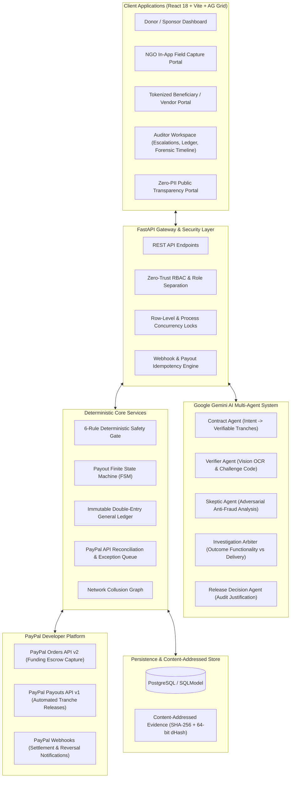

# ImpactRelease Architecture & System Design

**ImpactRelease** is an autonomous, milestone-verified grant escrow and disbursement platform engineered with distributed concurrency control, immutable double-entry bookkeeping, multi-agent adversarial deliberation, and PayPal REST financial rails.

🌐 **Production Deployment:** [https://impact-release.onrender.com/](https://impact-release.onrender.com/)  
📖 **API Documentation (Swagger UI):** [https://impact-release.onrender.com/docs](https://impact-release.onrender.com/docs)

---

## 1. High-Level System Architecture

---

## 2. Core Architectural Subsystems

### 2.1 Concurrency Control & Balance Invariants
To prevent double-disbursement and race conditions during simultaneous administrator actions or concurrent webhook deliveries:
1. **Database Row-Level Locking:** All milestone disbursement logic executes inside a database transaction wrapped in `with_for_update()` on the target `Project` row.
2. **Process-Level Locking:** `get_project_lock(project_id)` serializes in-flight execution per project in memory, preventing thread contention during intermediate session operations.
3. **Holdback Invariant Guarantee:** Regular milestone payouts are capped at:
   $$\text{Available Regular Balance} = \text{Captured Funds} - \text{Total Prior Releases} - \text{Holdback Amount}$$
   The holdback reserve cannot be touched until **100% of standard milestones reach terminal `SETTLED` status** and no open disputes remain.

### 2.2 Immutable Double-Entry General Ledger
Rather than maintaining a single mutable balance column, ImpactRelease maintains an immutable, double-entry General Ledger (`JournalEntry` table):
- **Balanced Journaling:** Every financial transaction posts paired Debit and Credit records.
- **Chart of Accounts:**
  - `Assets:PayPal_Escrow_Holdings`: Tracks physical funds held in the platform's PayPal merchant balance.
  - `Liabilities:Grantee_Escrow_Allocation`: Tracks the platform's obligation to release funds upon proven milestones.
  - `Expenses:Payout_Disbursement`: Tracks finalized settlements to NGOs.
- **Compensating Reversals:** Cancelled or refunded transactions generate compensating reversal entries (`is_reversal=True`, `reversal_of_id=<id>`), ensuring historical audit logs are never modified or deleted.
- **Mathematical Integrity Proof:** `GET /ledger/journal/verify` verifies $\sum \text{Debits} \equiv \sum \text{Credits}$ with net zero balance drift.

### 2.3 Multi-Agent Investigation Workflow
Beyond basic verification, the system features an autonomous investigation engine ([`investigation_workflow.py`](../backend/app/agents/investigation_workflow.py)) synthesizing findings from three specialized agents:
- **Contract Agent:** Establishes objective physical proof requirements.
- **Verifier Agent:** Validates challenge codes, placard timestamps, and invoice line items.
- **Skeptic Agent:** Probes for recycled images, inflated invoices, and collusion risks.
- **Investigation Arbiter:** Evaluates whether evidence demonstrates **Outcome Functionality** (e.g. operational water filtration, student attendance logs) versus mere **Delivery Manifests** (unopened boxes, raw pipes). It automatically assigns targeted remediation actions:
  - `REQUEST_FUNCTIONAL_PROOF`: Demands operational performance proof before release.
  - `REQUEST_VENDOR_ITEMIZATION`: Requires line-item vendor bills when discrepancies arise.
  - `ESCALATE_HUMAN_AUDIT`: Escalates high-risk submissions to the Auditor Workspace.

### 2.4 Monotonic Payout Finite State Machine (FSM)
Payout lifecycles follow a strict forward-only transition graph:
$$\text{PENDING} \longrightarrow \text{PROCESSING} \longrightarrow \text{SETTLED}$$
- Backward transitions (e.g. `SETTLED` $\to$ `PROCESSING`) are strictly rejected and logged in the `FinancialDiscrepancy` exception queue.
- Intermediate failure states (`DENIED`, `FAILED`, `REFUNDED`) release reserved funds back to the project's available pool and post compensating ledger reversals.

### 2.5 Automated PayPal Reconciliation Engine
Webhooks are asynchronous and can be delayed or lost. ImpactRelease implements an active reconciliation service:
- Periodically queries PayPal's `GET /v1/payments/payouts/{payout_batch_id}` API.
- Reconciles orphaned `PENDING` or `PROCESSING` payouts without waiting for external webhooks.
- Populates an auditor **Exception Queue** accessible via `GET /reconciliation/discrepancies` and `POST /reconciliation/run`.

### 2.6 Zero-Trust Role-Based Access Control (RBAC)
- **Role Isolation:** Donors (`sponsor`), NGOs (`ngo`), External Verifiers (`verifier`), and Administrators (`admin`) have strictly bounded capabilities.
- **No NGO Self-Approvals:** `POST /milestones/{id}/release` verifies the caller's role. If an NGO attempts to authorize release of their own milestone, the request is rejected with **HTTP 403 Forbidden**.
- **Admin Record Protection:** Administrators cannot directly alter journal balances or posted financial records without triggering logged compensating journal entries.

### 2.7 Content-Addressed Evidence Store
- Field evidence files are hashed using SHA-256 upon ingestion and saved by cryptographic digest.
- Prevents path traversal vulnerabilities and enables byte-level duplicate detection.
- Generates 64-bit perceptual difference hashes (`dHash`) to detect image resizing, recompression, and cropping across different projects (Hamming distance $\le 10$).

---

## 3. Forensic Project Audit Trail
ImpactRelease exposes a 7-point forensic audit trail via `GET /audit/timeline/{project_id}` that provides complete end-to-end accountability:
1. **Who Funded:** Sponsor identity, pledge amount, and payment intent.
2. **When Captured:** PayPal order ID, capture transaction ID, and timestamp.
3. **What Evidence:** Content-addressed file hashes, camera provenance, and challenge codes.
4. **Which AI Verified:** Verifier confidence score, Skeptic fraud score, and investigation actions.
5. **Who Attested:** Vendor and beneficiary confirmation token hashes and verification timestamps.
6. **Which Gate Passed:** Deterministic 6-rule gate results and audit justifications.
7. **Which Transaction Disbursed:** PayPal Payout batch ID, item transaction ID, and general ledger journal postings.
