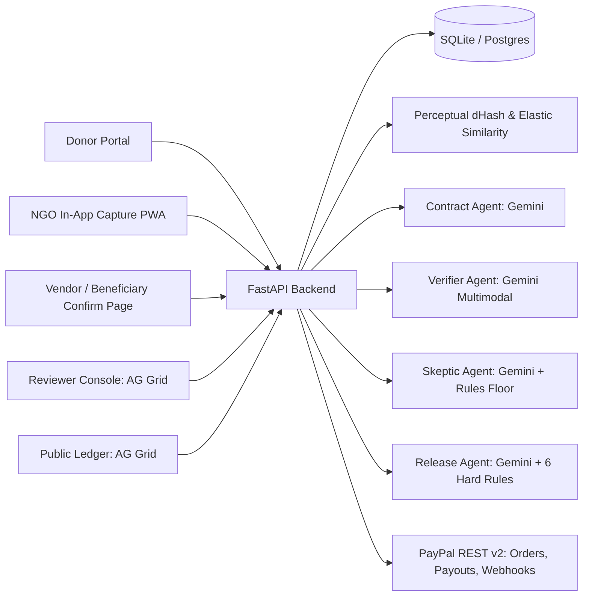

# ImpactRelease Architecture

## System Overview

## Key Design Invariants
1. **Agents Never Call PayPal Directly:** Only [`release_service.release_milestone`](../backend/app/services/release_service.py) can create a PayPal Payout, and only after a milestone reaches `APPROVED_FOR_RELEASE`.
2. **Deterministic Rules Floor:** Both the Adversarial Skeptic Agent and the Release Decision Agent operate on top of deterministic rule floors. An LLM can raise fraud risk or add concerns, but can never lower fraud risk below the deterministic floor or waive an unmet hard rule.
3. **Content-Addressed Evidence Storage:** Uploaded files are hashed with SHA-256 and stored by digest, preventing path traversal and enabling instant byte-duplicate detection alongside 64-bit perceptual difference hashing (`dHash`).
