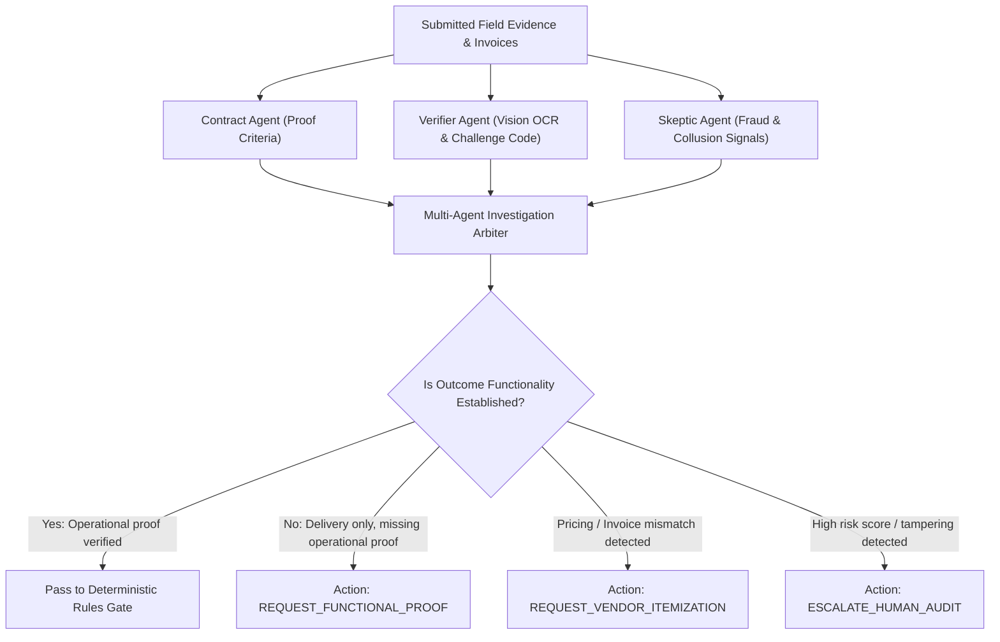

# Layered Anti-Fraud Model & Investigation Workflow

**ImpactRelease** is designed around a multi-layered defense-in-depth architecture combining computer vision, cryptographic challenge codes, perceptual hashing, network graph analysis, and adversarial multi-agent investigation to make fabricating or recycling evidence virtually impossible.

🌐 **Production Deployment:** [https://impact-release.onrender.com/](https://impact-release.onrender.com/)  
📖 **API Documentation (Swagger UI):** [https://impact-release.onrender.com/docs](https://impact-release.onrender.com/docs)

---

## 1. Multi-Layer Defense Matrix

| Layer | Implementation | Attack Vectors Caught |
|---|---|---|
| **1. Ephemeral Capture Controls** | Single-use 6-digit challenge codes (30-min TTL), capture-window validation, `in_app_camera` source tracking, SHA-256 digest storage | Pre-made stock photos, expired/replayed challenges, gallery uploads |
| **2. Perceptual Difference Hashing (`dHash`)** | 64-bit gradient difference hashing stored alongside evidence; cross-grant Hamming distance check ($\le 10$) | Resized, recompressed, slightly cropped, or color-adjusted recycled images |
| **3. Adversarial Multimodal AI** | Dual-agent deliberation: Verifier Agent (OCR, placard verification) vs. Skeptic Agent (tampering, pricing anomalies, suspicious metadata) | Missing challenge codes, blurry placards, inflated line-item receipts, fabricated invoices |
| **4. Multi-Agent Investigation Workflow** | Synthesis engine evaluating **Outcome Functionality** vs. **Delivery Manifests**; issues follow-up requirements | Delivering hardware or raw materials without operational proof (e.g. non-functional water pump, empty classrooms) |
| **5. Independent Third-Party Proof** | Single-use SHA-256 hashed magic-link tokens for vendors, sampled beneficiaries, and local community witnesses | Uncorroborated NGO claims, denied deliveries, colluding/scripted beneficiary replies |
| **6. Economic Deterrence & Invariants** | Tranche disbursements, 10%–20% retention holdback (`release-holdback`), pre-payout challenge windows, row-level balance locking | Lump-sum theft, hit-and-run defaults, concurrent double-spending |
| **7. Network Collusion Graph** | [`graph.py`](../backend/app/services/graph.py) (`GET /graph/risk`) tracking shared hardware device IDs across NGOs and repeat confirmers across projects | Sybil NGO accounts sharing one phone, professional fake confirmer rings |
| **8. Auditor Escalation & Forensic Timeline** | AG Grid workspace (`GET /review/queue`, `GET /audit/timeline/{project_id}`) with multi-agent investigation actions | Complex fraud rings, challenge-window disputes, forensic audit inquiries |
| **9. Continuous Red-Team Benchmark** | Automated evaluation suite [`eval/results.md`](../eval/results.md) testing 9 attack classes against legitimate baselines | Regression prevention, prompt-injection testing, adversarial resilience |

---

## 2. Multi-Agent Investigation Workflow

To solve the **"Photos vs. Reality"** challenge where an NGO uploads delivery receipts or photos of unopened hardware without proving actual operational impact, the system incorporates an autonomous Investigation Workflow ([`investigation_workflow.py`](../backend/app/agents/investigation_workflow.py)):

### Actionable Remediation Outputs:
1. `REQUEST_FUNCTIONAL_PROOF`: Flags that while materials were delivered, operational functionality (e.g. water potability testing, generator run logs) must be submitted before funds release.
2. `REQUEST_VENDOR_ITEMIZATION`: Triggered when invoice amounts or line items show variance against the contract budget.
3. `ESCALATE_HUMAN_AUDIT`: Escalates cases with elevated Skeptic risk or photo similarity anomalies directly to the Auditor Workspace.

---

## 3. Residual Risks & Non-Technical Countermeasures
- **Multi-party collusion:** If the NGO, vendor, and sampled beneficiaries all collude, purely digital checks can be bypassed; mitigated via random field audits, network collusion graph alerts (`/graph/risk`), and small tranche sizes.
- **Coerced confirmers:** Beneficiaries pressured into confirming delivery; mitigated via private single-use links and anonymous challenge-window dispute forms.
- **Sensor spoofing:** Rooted devices or GPS emulators; treated as weak signals that never replace independent third-party confirmation.
