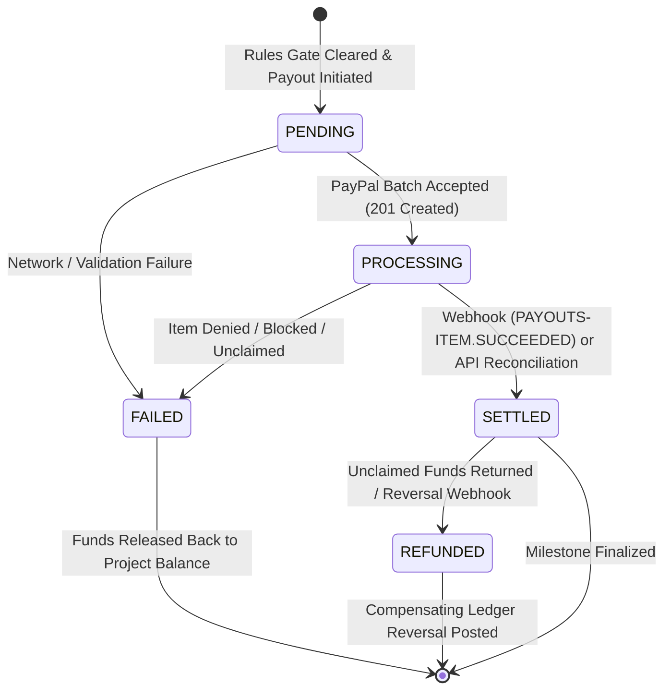

# PayPal Integration, Ledger & Payout Lifecycle Architecture

**ImpactRelease** integrates with the PayPal Developer Platform (REST v2/v1) to deliver transparent, milestone-gated grant escrow and automated tranche releases.

🌐 **Production Deployment:** [https://impact-release.onrender.com/](https://impact-release.onrender.com/)  
📖 **API Documentation (Swagger UI):** [https://impact-release.onrender.com/docs](https://impact-release.onrender.com/docs)

---

## 1. PayPal Endpoints & APIs Used

### 1.1 OAuth 2.0 Client Credentials
- **Endpoint:** `POST /v1/oauth2/token`
- **Authentication:** HTTP Basic Auth with `PAYPAL_CLIENT_ID` and `PAYPAL_CLIENT_SECRET`.
- **Token Management:** In-memory caching with automatic refresh prior to expiration.

### 1.2 Orders API v2 (Grant Funding Escrow)
- **Endpoints:**
  - `POST /v2/checkout/orders`: Creates the upfront funding order with `intent: "CAPTURE"` and dynamic return/cancel URLs configured via `RENDER_EXTERNAL_URL` or localhost.
  - `POST /v2/checkout/orders/{id}/capture`: Captures the donor's pledged capital into the platform's merchant balance.
- **Security & Integrity Checks:**
  - Verifies capture status is explicitly `COMPLETED`.
  - Asserts exact currency match (`USD`) and amount match against the grant total.
  - Enforces global uniqueness on `paypal_order_id` and `paypal_capture_id` to block replay attacks.
- **Double-Entry Journal Post:**
  - **Debit:** `Assets:PayPal_Escrow_Holdings` (+$Amount)
  - **Credit:** `Liabilities:Grantee_Escrow_Allocation` (+$Amount)

### 1.3 Payouts API v1 (Autonomous Milestone Tranche Releases)
- **Endpoints:**
  - `POST /v1/payments/payouts`: Issues instant payouts directly to the NGO's PayPal email address.
  - `GET /v1/payments/payouts/{payout_batch_id}`: Look up real-time batch and item payout statuses.
- **Idempotency & Resilience:**
  - Employs deterministic `sender_batch_id` (`milestone-{id}-{attempt}`) to prevent duplicate batch submissions.
  - Passes explicit `PayPal-Request-Id` HTTP headers for network-level retry safety.
  - Pre-records payout intent in PostgreSQL with status `PENDING` before the outbound API call.

### 1.4 Webhook Engine & Deduplication
- **Endpoint:** `POST /webhooks/paypal`
- **Cryptographic Signature Verification:** `POST /v1/notifications/verify-webhook-signature` using `PAYPAL_WEBHOOK_ID`.
- **Deduplication:** Logs each event in `WebhookEventRecord` with a database unique constraint on `event_id`. Duplicate webhook deliveries are safely acknowledged with HTTP 200 without creating duplicate ledger postings.
- **Supported Events:**
  - `PAYMENT.PAYOUTS-ITEM.SUCCEEDED`: Advances payout status to `SETTLED`. Posts Debit `Liabilities:Grantee_Escrow_Allocation`, Credit `Assets:PayPal_Escrow_Holdings`.
  - `PAYMENT.PAYOUTS-ITEM.REFUNDED`: Re-opens available funds and posts compensating reversal entries.
  - `PAYMENT.PAYOUTS-ITEM.FAILED` / `DENIED` / `BLOCKED`: Reverts status and releases reserved balance.
  - `PAYMENT.PAYOUTSBATCH.SUCCESS` / `PROCESSING` / `DENIED`: Synchronizes batch-level state.

---

## 2. Payout Lifecycle Finite State Machine (FSM)

### Monotonic State Invariant
Transitions are strictly forward-progressing. Backward status transitions (e.g. attempting to mark a `SETTLED` payout as `PROCESSING`) are blocked by `VALID_PAYOUT_TRANSITIONS` and automatically written to the `FinancialDiscrepancy` exception queue.

---

## 3. Double-Entry General Ledger

ImpactRelease maintains an immutable, double-entry General Ledger (`JournalEntry` table):
- `GET /ledger/journal`: Full chronologically ordered double-entry journal records.
- `GET /ledger/journal/verify?project_id={id}`: Mathematical verification asserting:
  $$\sum \text{Debits} \equiv \sum \text{Credits}$$
  and checking net account balances across all accounts.

### Chart of Accounts
- `Assets:PayPal_Escrow_Holdings`: Tracks funds physically held in the PayPal merchant escrow wallet.
- `Liabilities:Grantee_Escrow_Allocation`: Tracks the platform's obligation to disburse verified milestone tranches to field NGOs.
- `Expenses:Payout_Disbursement`: Settled milestone payments.

---

## 4. PayPal Reconciliation Service & Exception Queue

Webhooks should not be a single point of failure. ImpactRelease provides an independent reconciliation engine:
- **Endpoints:**
  - `POST /reconciliation/run`: Triggers a comprehensive scan against active payouts and captures.
  - `GET /reconciliation/discrepancies`: Fetches unresolved exceptions.
- **Automated Lookups:** Queries `get_payout(payout_batch_id)` via PayPal REST API to reconcile orphaned or delayed transactions.
- **Auditor Visibility:** Exposed directly inside the **Auditor Workspace** sub-tab in the React frontend.

---

## 5. Architecture & Compliance Analysis

### 5.1 Physical vs. Logical Fund Segregation
- **Hackathon Sandbox Implementation:** Standard PayPal developer accounts utilize an omnibus merchant balance where all captured funds reside. Physical per-grant bank accounts are not supported by standard SMB PayPal REST APIs.
- **ImpactRelease Logical Reservation:** The platform enforces strict fund isolation at the database and application tier:
  - Grants cannot exceed their allocated, captured funding balance (`available = funded_amount - released_amount`).
  - Row-level database locks (`with_for_update()`) prevent concurrent over-disbursement.
  - The retention holdback invariant guarantees regular milestones cannot deplete the final 10–20% reserve.
- **Production Architecture Roadmap:** For production multi-party fund custody, ImpactRelease is designed to integrate with **PayPal Commerce Platform (PPCP) for Marketplaces** with custom partner managed accounts, or partner with a chartered trust bank (via Banking-as-a-Service like Column or Evolve Bank & Trust) to maintain genuine FBO (*For Benefit Of*) segregated escrow accounts.

### 5.2 Long-Term Fund Custody & Regulatory Review
- **28-Day Deadline Avoidance:** Unlike authorization holds that expire after 28 days, ImpactRelease captures funds immediately on project funding into the escrow wallet, allowing grants to execute across months or years.
- **Custody Compliance:** Holding third-party funds for several months falls under Money Transmitter Licensing (MTL) and custodial regulatory frameworks (e.g., FinCEN in the US, PSD2 in the EU). In a commercial deployment:
  - The platform operates either under an agent-of-the-payee exemption, or
  - Partners with a licensed escrow provider / trust institution (PPCP or licensed trust rail) that directly holds the regulatory custody license, keeping ImpactRelease in the role of non-custodial milestone orchestration and AI verification engine.
